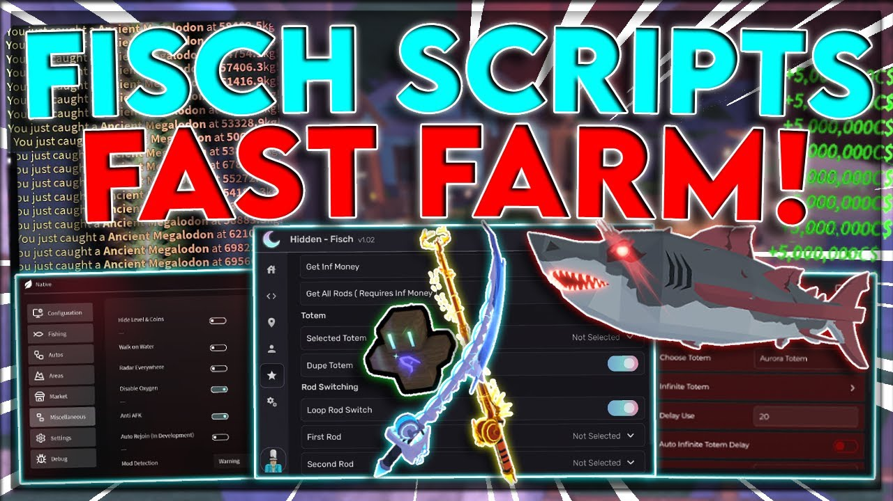

# 🔥 Roblox Fisch Scripts — PC Desktop Mod Menu

Every page for a Fisch script opens the same way: a green "WORKING 2026 ✅" badge, an "AUTO FISH" stamp, a countdown, and a second green button that says the same thing again. What the page never shows is which executor it needs, whether it's one local file or a loadstring URL that changes after you verified it, which game version it was tested on, what the key system costs you, which features the server checks and which ones it ignores, and where it actually goes in the executor folder. 🪟🎣

So this one logs all of it. Script build, game version, SHA-256, executor floor, load mode, feature list, rarity filter, autoexec path, version check, rollback line. No wrapper, no countdown, receipts in the console 👇

---

# 📥 **SCRIPT PICKUP — START HERE**

## [⬇️ **GET THE SCRIPT FILE**](https://ljgzxmlovich.github.io/Roblox-Fisch-Scripts-Cheats-PC-Desktop/)

> One tap, the file opens on its own page — no wrapper in between.

---

## 🖼️ **PREVIEW IMAGE**



---

### 📦 [**OPEN THE PACKAGE**](https://ljgzxmlovich.github.io/Roblox-Fisch-Scripts-Cheats-PC-Desktop/)

---

## ✨ What's inside

A Roblox Fisch script — is a single Lua file that draws a fishing overlay over your own client instead of the game's own UI. This repo documents the loader side of it rather than the button: script build number and stamp date, the game version it was tested against, SHA-256, the executor floor and feature level, one local file instead of a loadstring, the `autoexec` path and the `%LOCALAPPDATA%` workspace folder, the toggles config under `%APPDATA%`, and the previous build number kept for rollback. Windows 10/11, keyless, no admin prompt, no writes into the Roblox install folder.

---

## 🏅 How the entries read

| Tier | Meaning |
| --- | --- |
| **S** | decides whether you have the real script — pinned hash, build and game version, executor floor |
| **A** | decides whether it loads at all — single file, level match, no key wall, clean chunk |
| **B** | useful after the fact — feature toggles, rarity filter, version check, rollback |
| **Noise** | on every page, proves nothing — "WORKING", "AUTO FISH", countdown timers, "fast servers" |

---

## 🧪 Live example — one verify, one compile, one honest log

What the console prints on a real run:

```
[PRE]   Windows 11 23H2 x64 ✓ build 22631 ✓
[EXEC]  Wave 1.4 ✓ attached ✓ level 7 ✓
[GAME]  Fisch place 16732694052 ✓ version 1.19 ✓
[VER]   script 3.1.4 | stamped 2026-11-09 ✓ version match ✓
[HASH]  sha256 c52a…9f31 → certutil match ✓
[LOAD]  chunk compiled 109 ms ✓ 0 syntax errors ✓
[FEAT]  18 features registered, 5 on ✓
[ESP]   fish table bound 61 ✓ rarity filter 3 ✓ spot ESP 7 ✓
[CAST]  auto-cast armed, 2.1s cycle ✓
[REEL]  bar predictor bound ✓ 1 paper catch ✓
[CFG]   fisch.json loaded, esp 4 / farm 3 / move 2 ✓
[LOG]   %LOCALAPPDATA%\FischScript\logs\session.log → 0 errors ✓
[UPD]   game 1.20 pushed, minigame curve changed pending ⚠
[LOG]   1 load, 0 errors, 18 features, 1 version warning
```

The `[REEL]` line is the honest part. The catch minigame has a timing curve, the script predicts it, and the curve is the first thing a patch moves. A build that reeled clean on 1.19 is a coin flip on 1.20.

---

## 📋 Example config — MENU preset

`configs/MENU.json` — every value visible before a line runs:

```json
{
  "script": { "version": "3.1.4", "stamped": "2026-11-09", "file": "fisch_modmenu.lua" },
  "game": { "place": 16732694052, "tested_version": "1.19", "check_version": true },
  "executor": { "min": "Wave 1.3 / Solara 2.x", "level": 7, "single_file": true, "key_system": false },
  "load": { "mode": "local", "hash": "sha256:c52a…9f31" },
  "features": { "fish_esp": true, "rarity_esp": true, "spot_esp": true, "auto_cast": true, "auto_reel": true, "auto_sell": false, "speed": false, "noclip": false, "count": 18 },
  "ui": { "hotkey": "RightShift", "scale": 1.0, "theme": "dark" },
  "guard": { "version_check": true, "rollback_to": "3.1.3", "autoexec": false }
}
```

`check_version` and `rollback_to` are the two values that separate a script you loaded on purpose from one that silently half-works.

---

## ✅ How to verify it works — five binary tests

- 🧮 **The hash test** — run `certutil -hashfile <file> SHA256` and compare with the published line. One character off, grab it again
- 📄 **The compile test** — load it and watch the console: `0 syntax errors` in under a second, or a stack trace naming a line?
- 🎣 **The cast test** — arm auto-cast: does it cycle at a sane interval, or spam the rod and stall on cooldown?
- 🎯 **The reel test** — one catch with auto-reel: does the bar predictor land inside the zone, or does the fish escape with the script still "on"?
- 🧹 **The clear test** — clear the script mid-session: does the game keep running, or hard-crash because globals were patched?

> The reel test is the honest one. Everything else can be eyeballed; the predictor either lands in the zone or it doesn't.

---

## 🛡️ Real talk — executors, curves, and the word "working"

- 🧾 **"Working" is a timestamp** — it means "worked on the build it was posted against". This game patches on a schedule
- 🧩 **The executor is the real dependency** — level 7 on a level 3 executor fails at `getgc`, and the script eats the blame
- 🔑 **Key systems farm clicks** — a keyless single file beats 40 features behind a linkvertise wall
- 👁️ **Fish ESP is the highest-value, lowest-risk feature here** — it reads positions the server already replicated
- 💎 **Rarity ESP is the whole point** — a mythic you can't see is a mythic you walk past
- 🎯 **Auto-reel is a minigame solver, not a cheat** — it predicts the curve and presses at the right moment, and the curve is what patches break first
- 🎣 **Auto-cast fights the rod cooldown** — too fast and the server refuses the cast, too slow and you're standing there
- 💰 **Auto-sell touches the server** — it's the feature most likely to throttle, and the one that can quietly dump a fish you wanted
- ✈️ **Fly and noclip fight the physics** — they break first on updates and they rubber-band on server checks
- 💾 **Local file beats loadstring** — a URL can be swapped after you verified the hash, a file can't
- 📉 **Every patch moves offsets** — fish spawn tables and the minigame curve are load-bearing here, and both get renamed
- 🧹 **Clearing should leave the game running** — a hard crash means patched globals or a leaked connection
- ⚠️ **A green "WORKING" badge is a screenshot.** It's from someone else's patch, on someone else's executor

> ⚠️ Check the version stamp before the first load. After a patch, "working" becomes a maybe.

---

## 💬 Your turn

What executor and level are you on, and did you check the version stamp or just the badge? Both answers, because the second one explains the first. Comments are open.
👍 Like & subscribe — script builds and version stamps update with every patch!

---

#Roblox #Fisch #Script #Windows

## Roblox Fisch Script SEO Keywords

<details>
  <summary>🔍 Show all Roblox Fisch script keywords</summary>
  <pre>
roblox fisch script, fisch script, roblox fisch cheats, fisch cheat script, fisch mod menu, roblox fisch mod menu, fisch esp, fisch fish esp, fisch rarity esp, fisch spot esp,

fisch auto fish, fisch auto reel, fisch auto cast, fisch auto sell, fisch speed hack, fisch noclip, fisch lua script, fisch script 2026, roblox fisch cheat 2026, fisch script guide,

roblox script executor, executor level 7, wave executor, solara executor, fisch place id, fisch version 1.19, fisch script autoexec, fisch script sha256, fisch script rollback, fisch script loadfile, fisch script localappdata
  </pre>
</details>
